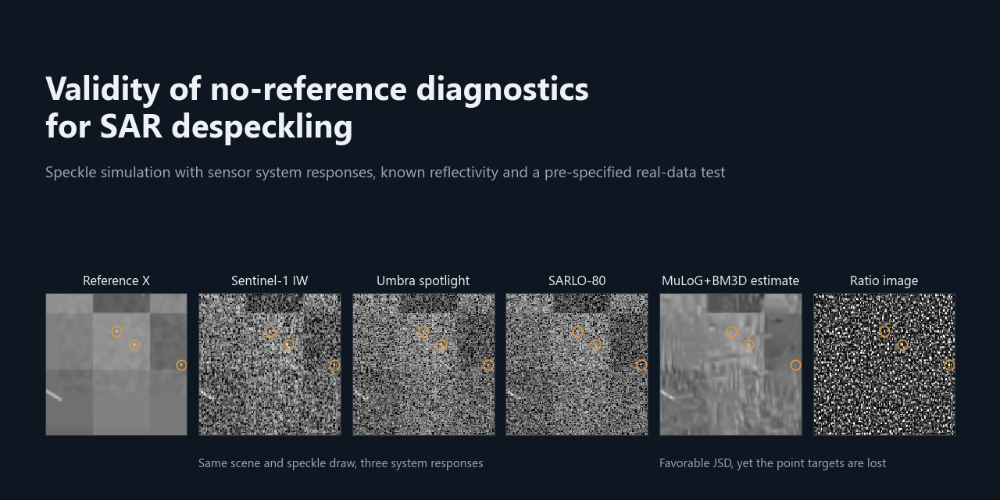
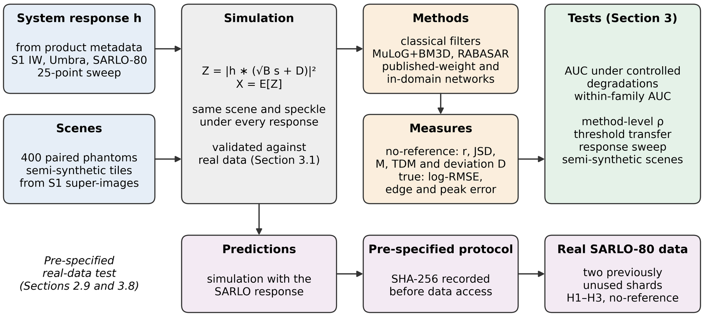
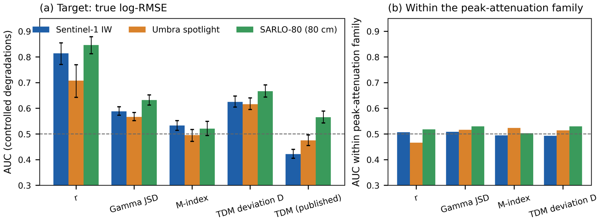
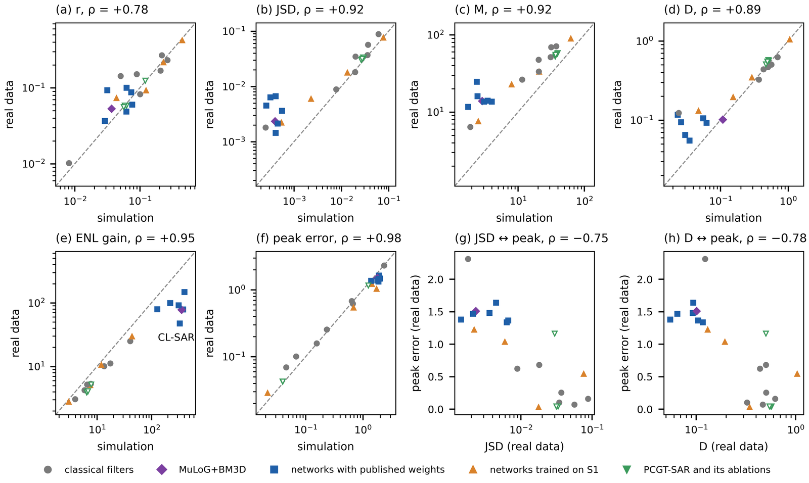

# Validity of no-reference diagnostics for SAR despeckling



Code, result tables and the pre-specified protocol of the article

> M. Balcı and M. Y. Erten, "Sensor- and Scene-Dependent Validity of No-Reference Diagnostics for SAR Despeckling,"
> *Remote Sensing*, [AUTHORS: year, volume, article number and DOI after publication].

Despeckling methods for real SAR data are usually compared with no-reference diagnostics computed on the ratio image
between the observation and the estimate. This repository contains the speckle simulator with system responses derived
from Sentinel-1 IW, Umbra spotlight and SARLO-80 product metadata, the diagnostics and the true error measures, the
controlled degradations, the statistical analysis, the per-patch results of the study and the protocol of the real-data
test, which was fixed before the data were downloaded.



## Main findings

* On 400 paired phantoms under controlled degradations, the ratio-edge measure *r* separated the true log error best
  (AUC 0.708–0.846), but its AUC depended on the system response. The published orientation of the texture–divergence
  measure inverted under correlated speckle, and no diagnostic reliably detected the attenuation of sparse point targets.
* At the method level, the Gamma Jensen–Shannon divergence and the M-index followed the true error but were inversely
  related to the point-target error, so they favored methods that suppressed strong scatterers.
* Predictions fixed before data access were tested on 284 previously unused SARLO-80 records. Method profiles
  transferred for six measures (Spearman ρ = 0.78–0.98), whereas absolute values did not.





## Contents

```
sardiag/                  Python package
  simulation.py           system responses, phantoms, speckle simulation, temporal-median bias
  diagnostics.py          ratio-edge measure r, Gamma JSD, M-index, TDM and its two-sided deviation D
  metrics.py              true errors: log-RMSE, edge error, point-target error, PSNR, SSIM, ENL
  degradations.py         controlled degradations with known amounts of error
  evaluation.py           evaluation of one estimate against a simulated scene
  real_data.py            diagnostics and observation-referenced measures for real data
  statistics.py           AUC, rank correlations, bootstrap, permutation tests, Holm correction
scripts/
  validate_simulator.py   impulse responses, speckle correlation, temporal-median bias and error floor
  controlled_degradations.py  regenerates the controlled-degradation series and its AUCs
  evaluate_despeckler.py  template for evaluating a new despeckling method
  reproduce_results.py    recomputes the main results from the released tables
results/                  per-patch result tables and recomputed summaries (see results/README.md)
protocol/                 pre-specified protocol of the real-data test and its SHA-256 hash
tests/                    unit tests and comparisons with the released tables
docs/images/              figures shown on this page
```

## Installation

Python 3.11 or later is required. The package depends only on NumPy, SciPy and pandas.

```bash
git clone [AUTHORS: repository URL]
cd sar-despeckling-diagnostics
python -m pip install -r requirements.txt
```

The code was tested with Python 3.11, NumPy 2.4, SciPy 1.17 and pandas 3.0.

## Usage

Simulate a phantom, despeckle it and compare the no-reference diagnostics with the true errors:

```python
from scipy.ndimage import uniform_filter
from sardiag import evaluation, simulation

item = next(iter(simulation.phantom_set("eval", "s1", n=1)))
estimate = uniform_filter(item["noisy"], size=7)
result = evaluation.evaluate(item["noisy"], estimate, item["clean"], item["coords"], item["mask"])
print(result["true_log_rmse"], result["r"], result["gamma_jsd"], result["tdm_deviation"])
```

For real data, where the reflectivity is unknown, `sardiag.real_data.real_data_measures(noisy, estimate)` returns the
diagnostics together with the ENL gain and the strong-scatterer peak error, both referenced to the observation.

To evaluate a new method under the three responses, replace `despeckle()` in `scripts/evaluate_despeckler.py` and run

```bash
python scripts/evaluate_despeckler.py --phantoms 20
```

## Reproducing the results

| Command | Result | Paper |
|---|---|---|
| `python scripts/validate_simulator.py` | Impulse responses, lag-1 correlation, temporal-median bias and error floor | Table 2, Sections 2.5 and 3.1 |
| `python scripts/controlled_degradations.py --response s1` | Controlled-degradation series and AUCs from the simulator | Table 6 |
| `python scripts/reproduce_results.py` | AUCs, method-level correlations, response sweep and hypotheses H1–H3 from the released tables | Tables 6, 7, 9 and 10, Figure 6 |
| `python -m unittest discover -s tests` | The package reproduces rows of the released tables | |

All simulations are deterministic. `reproduce_results.py` uses the seeds and the order of draws of the study, so its
confidence intervals and p-values agree with the paper. With `--quick`, it prints the point estimates in about one
minute without writing files.

## Scope of the release

The despeckling methods themselves are not part of this repository. The classical filters follow their published
equations, and MuLoG+BM3D, SAR2SAR, MERLIN and CL-SAR were run with publicly available implementations and, for the
networks, the weights released by their authors, as described in Section 2.8 of the paper. PCGT-SAR is an
unpublished method of the authors; its outputs are included in the result tables, and its code is available from the
corresponding author on reasonable request. The protocol records the hashes of the original study code used for the
real-data test.

## Data

* Sentinel-1: Copernicus Data Space Ecosystem, <https://dataspace.copernicus.eu>.
* Umbra: Umbra Open Data Program, CC BY 4.0.
* SARLO-80: ONERA, CC BY-SA 4.0. The selected shards and their hashes are listed in `protocol/PROTOKOL.json`.

## Citation

If you use this code or the results, please cite the article above. Citation metadata are given in `CITATION.cff`.

## License

The code is released under the MIT License (see `LICENSE`). The result tables are released under CC BY 4.0, except the
real-data measures, which follow the CC BY-SA 4.0 license of SARLO-80.
